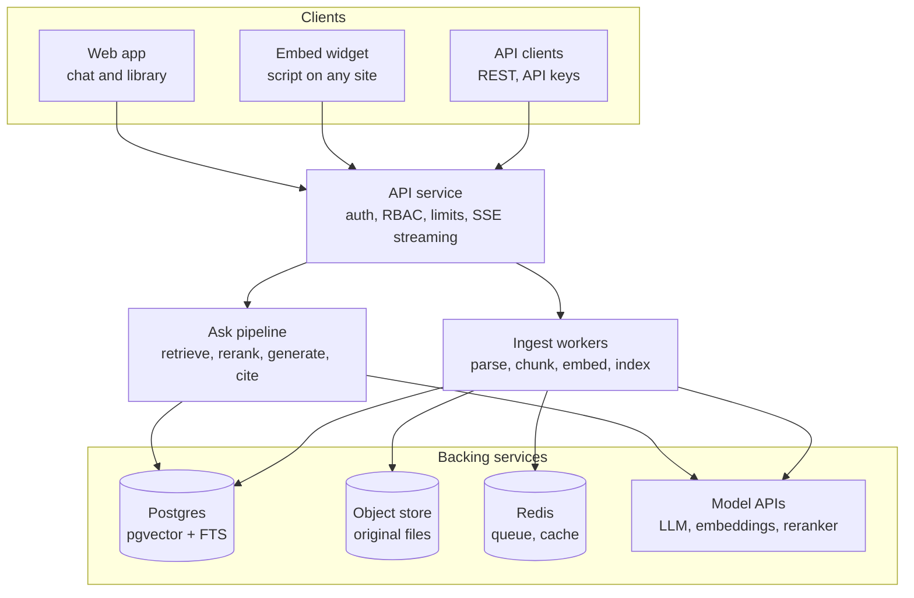

# Docent: system architecture

Stateless API and background workers over one Postgres, object storage, and Redis. Model calls sit behind a provider interface.

> **v1 deployment note:** on the $0 budget, the API and workers run as one service with a Postgres job queue and no Redis ([ADR 0005](./adr/0005-single-backend-service-postgres-queue.md)); Postgres, auth, and object storage come from Supabase ([ADR 0006](./adr/0006-supabase-for-database-auth-storage.md)). The diagram below is the target shape the code is structured for.

## Overview

## Ask path (~1.1 s to first token)

1. Authz: resolve collections the user can read
2. Rewrite follow-up → standalone query (skip on turn 1)
3. Retrieve: pgvector HNSW + FTS, `WHERE collection_id IN (allowed)`, merge via RRF
4. Rerank top 50 → 6–8 chunks
5. Prompt: numbered chunks as quoted data; weak scores → skip LLM, return “not found”
6. Stream tokens over SSE
7. Verify citations against chunk text; drop unsupported claims
8. Persist message + trace (chunks, prompt, model, latency, cost)

Budget: rewrite 250 ms, retrieve 80, rerank 150, LLM first token 600.

## Ingest path

- Presigned upload → object store; doc row `queued`; job on Redis
- Worker: parse → heading-aware chunk → hash each chunk
- Embed only unseen hashes (batched); upsert; doc `indexed`
- Idempotent retries; dead-letter after N fails; status pushed to UI

## Decisions

- One Postgres for vectors, FTS, perms, chats, logs: permission filter inside retrieval SQL, never post-filtered
- Embedding model + version per chunk: swap = background re-embed, then atomic cutover
- LLM, embedder, reranker behind one provider interface: fallback on outage
- LLM gets no tools, chunks are data: injection can’t act
- Eval suite in CI on fixed question set; regressions block merge
- Scale: stateless API replicas + PgBouncer; workers autoscale on queue depth; split out vector store past ~10M chunks

## Tables

`users`, `collections`, `memberships`, `documents`, `chunks`, `conversations`, `messages`, `answer_logs`, `api_keys`, `share_links`
