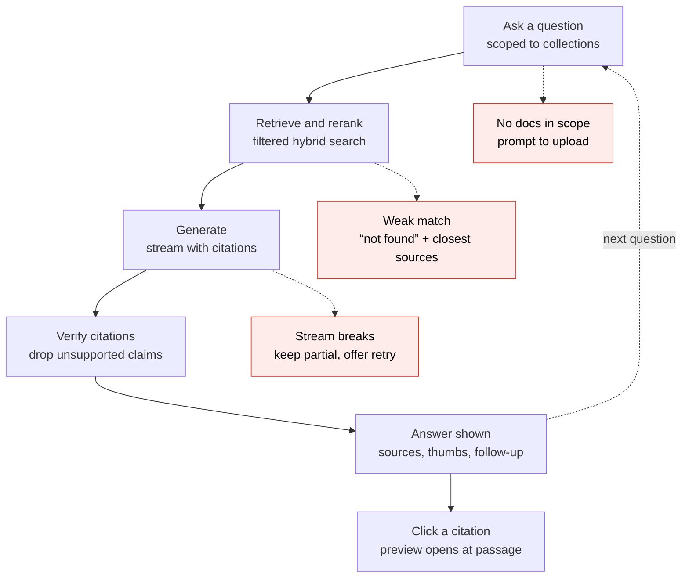

# Docent: core application flows

## Ask

Solid arrows: main path. Dotted: edge paths and the follow-up loop.

## Onboard

- Sign in (email/Google) → empty library, one CTA: upload
- Create collection → drop files → per-file status → ask
- Asking allowed while indexing: answers use indexed docs only, banner “3 of 12 indexing”

## Doc status

`uploading → queued → parsing → embedding → indexed`, or `failed` (reason, retry, remove)

- `uploading`: the browser is sending the file to storage; an upload never reported finished fails after an hour
- Bad file fails alone; batch continues
- Replace (from the Document, or when an upload's name matches one): chunk-hash diff, re-embed changed only; the Document answers as it is until the replacement is indexed, then they swap; one replacement at a time, identical content refused; a failed replacement shows why, with retry or dismiss; the Effective Date stays
- Delete: confirm → chunks + vectors purged together; old citations show “source removed”
- Move: to another Collection where the User is Owner or Editor (never the Demo); only Ready or Failed Documents with no replacement on the way; passages move with it, so retrieval follows at once and earlier citations open for whoever can read the new Collection; the same content already there is refused

## Share

- Owner invites email + role (Editor or Viewer) → copies the invite link and sends it themselves (Docent sends no email) → recipient signs in with that address → collection under “Shared with me”
- Signing in with the invited address is enough, link or not; the link works only for that address, and shows who it is for (partly hidden) to anyone else
- Invites last 14 days; inviting again updates the Role and renews it, keeping the link
- Personal Collection is never shared; Demo Collection has no Owner
- Role change or revoke takes effect on next query (permissions live in retrieval SQL)
- Pending invites: copy link again, cancel
- People with access: every Member sees the list (not for the Demo Collection, whose Members are every User); the Owner changes Roles, removes Members, and transfers ownership (the old Owner stays as an Editor); anyone else can leave; the Owner can't leave without transferring first

## Publish

- Owner toggles public (+ optional expiry) → link + embed snippet
- Visitor asks anonymously, rate-limited per IP; answers cite only that collection
- Off or expired: widget shows “unavailable”, API returns 404

## Improve

- Thumbs down + reason → saved with full trace in the Answer Log
- On the Demo Collection only, the maintainer promotes it to the Eval Set (question + expected passage); CI guards regressions
- Private Collections never feed the Eval Set; per-Collection eval sets for Owners are post-v1
- Nothing auto-trained; human in the loop
